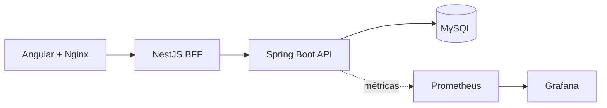

<div align="center">

# Sistema de Vendas | Arquitetura Full Stack

### Aplicação de referência que integra Angular, um BFF NestJS, serviços Java/Spring Boot e MySQL, com ambiente de observabilidade.

[](https://github.com/KalleoLeandro/sistema-vendas-angular-node-java)


       

</div>

---

## ✨ Visão geral

Aplicação de referência que integra Angular, um BFF NestJS, serviços Java/Spring Boot e MySQL, com ambiente de observabilidade.

## 🚀 O que você encontra aqui

- **Separação entre interface, BFF e API de negócios**
- **Ambiente integrado por Docker Compose**
- **Monitoramento com Prometheus e Grafana**
- **Análise de qualidade estática com SonarQube**

## 🧰 Tecnologias

`Angular`, `TypeScript`, `NestJS`, `Java`, `Spring Boot`, `MySQL`, `Docker`, `Prometheus`, `Grafana`, `SonarQube`.

## 🖼️ Visão técnica / demonstração



## ▶️ Como explorar / executar

```bash
docker compose up --build -d
```
Serviços publicados pelo Compose: Angular `localhost:4200`, BFF `localhost:3000`, back-end `localhost:8080`, Grafana `localhost:3001`, Prometheus `localhost:9090` e SonarQube `localhost:9000`. Ajuste senhas, tokens e configurações antes de expor o ambiente.

## 📁 Repositório

```bash
git clone https://github.com/KalleoLeandro/sistema-vendas-angular-node-java.git
cd sistema-vendas-angular-node-java
```

[Consultar os arquivos e o histórico do projeto](https://github.com/KalleoLeandro/sistema-vendas-angular-node-java)

## 📝 Observações

> **Atenção:** o Compose de referência contém credenciais locais demonstrativas. Não implante em rede pública sem revisá-las.

---

<div align="center">

Desenvolvido e mantido por [Kalleo Leandro](https://github.com/KalleoLeandro).

</div>
